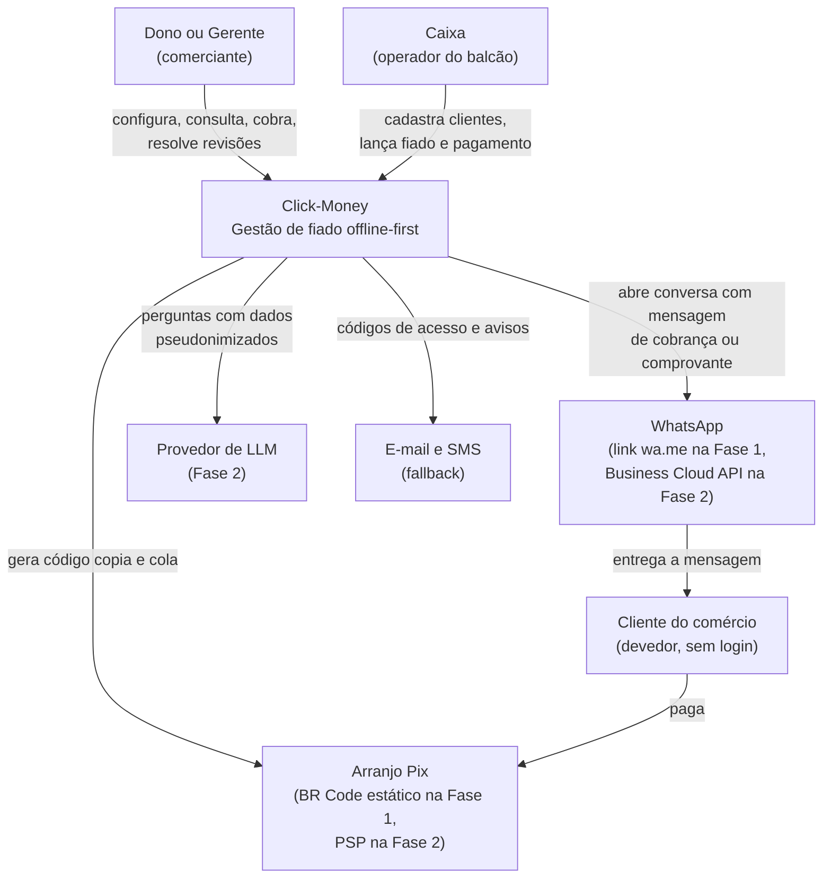
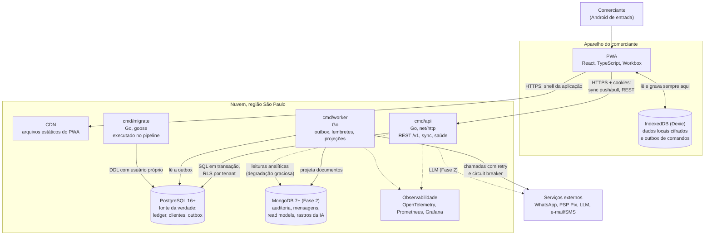
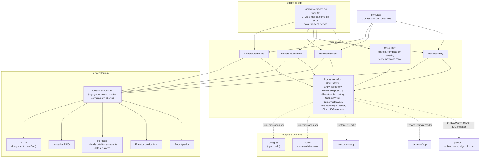

# Diagramas C4

Três níveis: contexto, contêineres e componentes do módulo `ledger`. As decisões por trás de cada caixa estão nos [ADRs](../adr/README.md).

## Nível 1 — Contexto

## Nível 2 — Contêineres

Em desenvolvimento local, `api` e `worker` usam um único arquivo SQLite no lugar de PostgreSQL e MongoDB, pelas mesmas portas (ADR 0002).

## Nível 3 — Componentes do `ledger`

Pontos a observar:

- O agregado `CustomerAccount` é a unidade de consistência: carrega o saldo, a versão e as compras em aberto de um cliente, aplica o lançamento e devolve o que deve ser gravado (lançamento, alocações, novo saldo, eventos).
- O módulo `sync` não tem regra de ledger própria: chama os mesmos casos de uso que os handlers HTTP.
- `ledger` conhece `customers` e `tenancy` só por portas de leitura que ele mesmo define.
