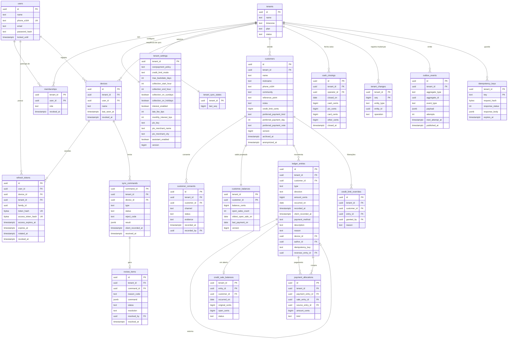

# Diagrama ER (PostgreSQL)

Modelo relacional da Fase 1. Tipos na notação do PostgreSQL; no SQLite, `uuid` e `timestamptz` viram `text` (ADR 0002). Toda tabela tem `created_at`, e as mutáveis têm `updated_at`; essas colunas foram omitidas do diagrama quando não acrescentam informação.

## Constraints e índices que o diagrama não mostra

| Tabela | Regra |
| --- | --- |
| `ledger_entries` | `CHECK (amount_cents > 0)`; `CHECK` de `type`, `direction` e `payment_method`; `CHECK` que amarra tipo e direção; `UNIQUE (tenant_id, idempotency_key)`; `UNIQUE (reverses_entry_id)`; trigger e permissão que negam `UPDATE` e `DELETE`; FKs `ON DELETE RESTRICT` |
| `ledger_entries` | Índice `(tenant_id, customer_id, occurred_on DESC, id DESC)` para o extrato; índice `(tenant_id, occurred_on, author_id)` para o fechamento de caixa |
| `customers` | Índice único parcial `(tenant_id, phone_e164) WHERE archived_at IS NULL AND phone_e164 IS NOT NULL`; índice de busca por nome e apelido normalizados |
| `customer_balances` | Índice `(tenant_id, balance_cents DESC, customer_id)` para a lista de devedores; índice `(tenant_id, oldest_open_sale_on)` para o aging |
| `credit_sale_balances` | `CHECK (open_cents BETWEEN 0 AND original_cents)`; índice parcial `(tenant_id, customer_id, occurred_on, entry_id) WHERE open_cents > 0` para a alocação FIFO |
| `payment_allocations` | `CHECK (amount_cents > 0)`; `kind` em `ALLOCATE` ou `RELEASE`; somente-inserção |
| `memberships` | `role` em `OWNER`, `MANAGER`, `CASHIER`; ao menos um `OWNER` ativo por tenant (verificado no caso de uso) |
| `outbox_events` | Índice parcial `(next_attempt_at) WHERE published_at IS NULL` |
| Todas as de negócio | RLS por `tenant_id` (ADR 0008); FKs compostas com `tenant_id` |

## Coleções do MongoDB (Fase 2)

| Coleção | Conteúdo | Retenção (TTL) **[PREMISSA]** |
| --- | --- | --- |
| `audit_trail` | Quem, quando, de qual dispositivo, antes e depois | 5 anos |
| `sync_logs` | Lotes de push e pull por dispositivo | 90 dias |
| `messages` | Cobranças e comprovantes enviados, status de entrega | 2 anos |
| `message_templates` | Modelos de mensagem por tenant | sem expiração |
| `assistant_runs` | Passos, ferramentas, tokens, custo, avaliação | 180 dias |
| `read_models` | Aging e indicadores pré-agregados | reconstruível |

Todas com validação `$jsonSchema` e índice iniciado por `tenant_id`.
