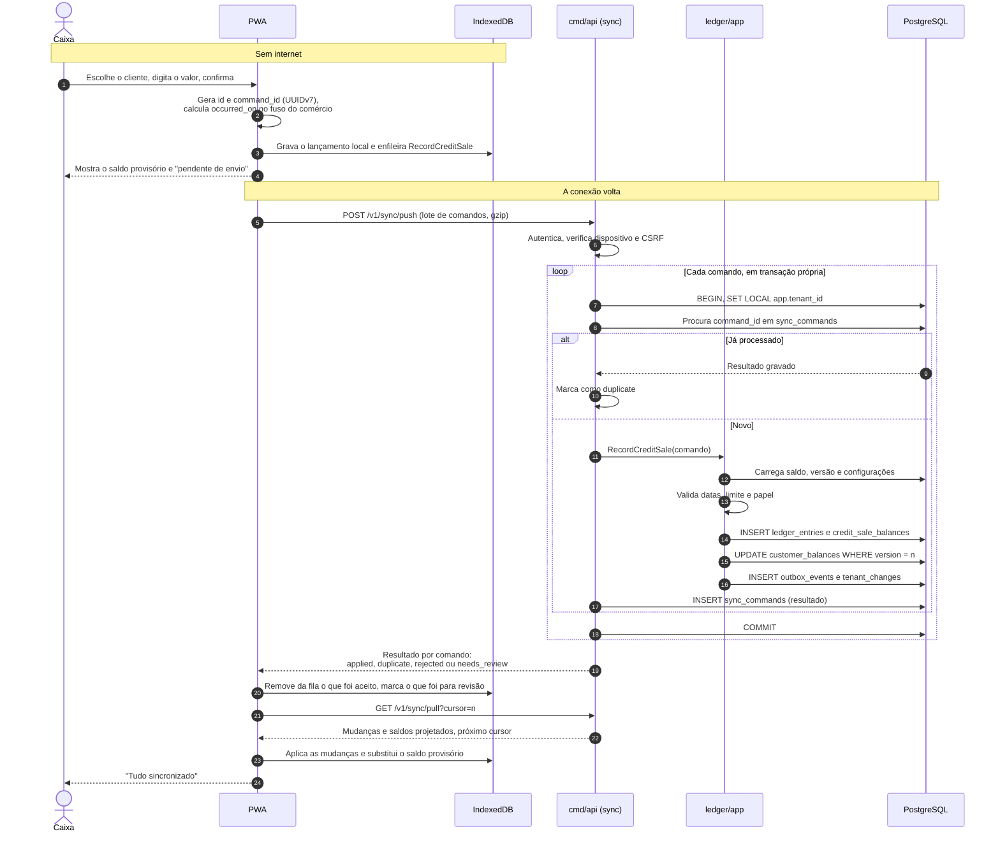
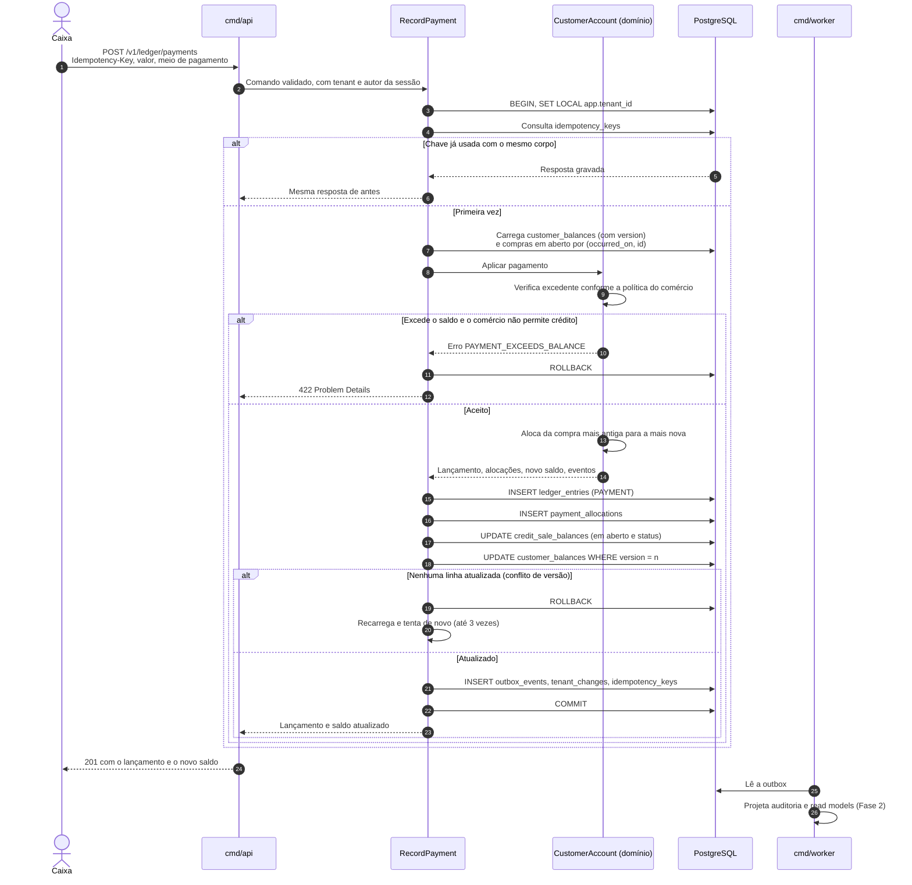
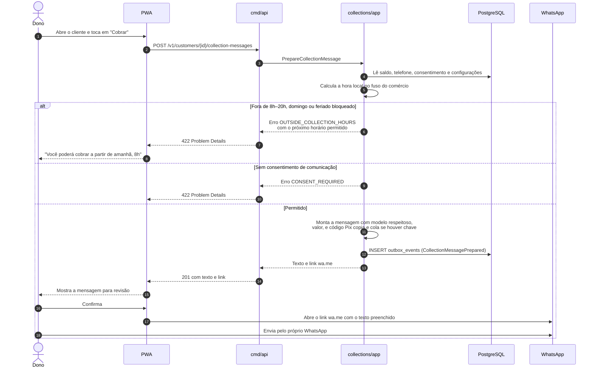
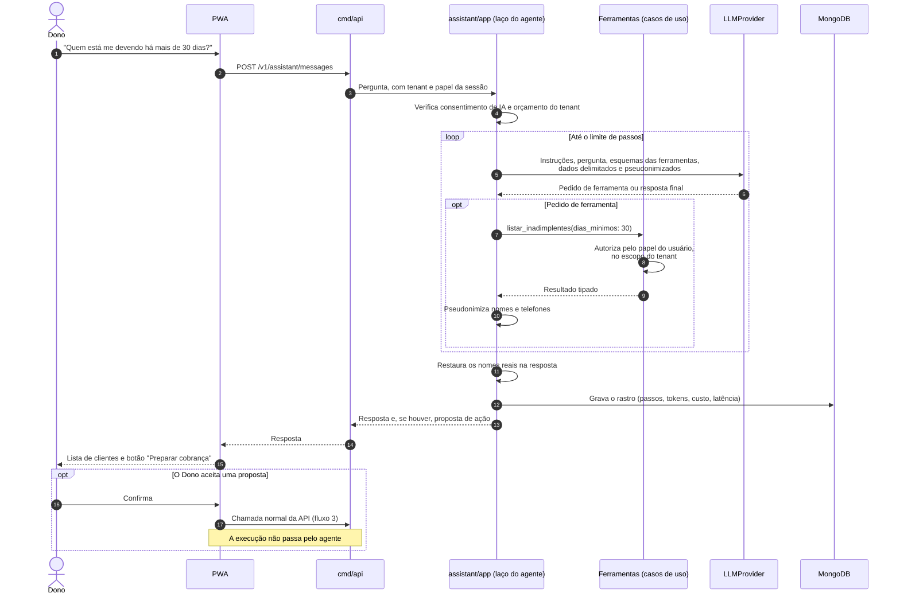

# Diagramas de sequência

## 1. Lançar fiado offline e sincronizar

Se a resposta do push se perder, o PWA reenvia o mesmo lote com backoff e jitter; a consulta a `sync_commands` garante que nada é lançado duas vezes.

## 2. Pagamento com alocação FIFO

## 3. Cobrança via WhatsApp (Fase 1, link `wa.me`)

Na Fase 1 quem envia é o próprio comerciante, pelo aplicativo dele; o sistema registra que a mensagem foi preparada, não que foi entregue. Na Fase 2 o envio passa pela API oficial, com webhook de status.

## 4. Consulta ao assistente (Fase 2)

